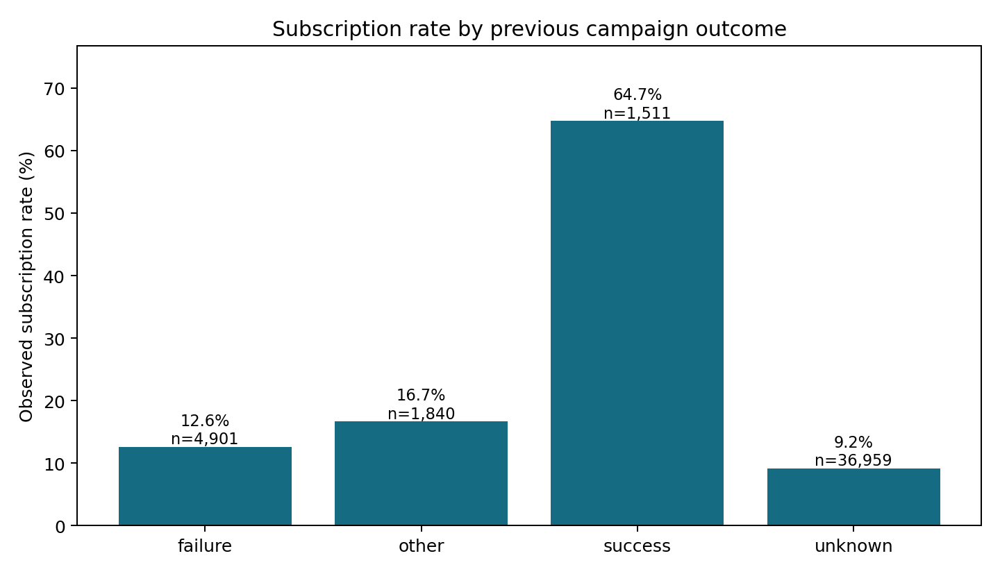
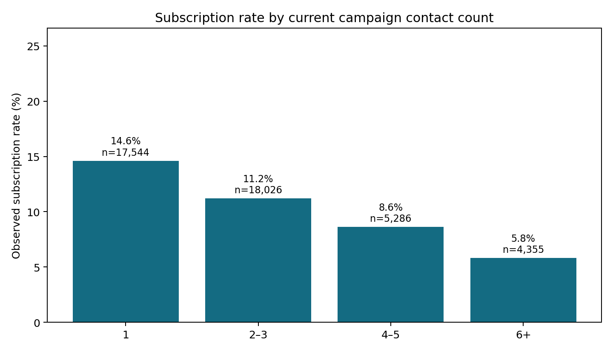

# Which customers should a bank call first?
## Three lessons from 45,211 marketing records

By SAM · 1 October 2026

When a marketing team has more prospects than time, the useful question is not simply how to make more calls. It is how to use a limited calling budget intelligently. I analyzed the public UCI Bank Marketing dataset to investigate three questions: does past campaign success identify promising customers, how does conversion vary with repeated contact, and can information available before a call help prioritize prospects?

The dataset describes phone campaigns at a Portuguese banking institution. I used the older, full `bank-full.csv` version: 45,211 records, with 5,289 term-deposit subscriptions. The overall subscription rate is **11.70%**. These are historical observations, not a trial of a new marketing policy. They can suggest useful experiments, but cannot establish what would happen if another bank copied the strategy.

### 1. Does a successful previous campaign identify promising customers?

Yes, in this dataset the relationship is substantial. Customers recorded as having a successful previous campaign subscribed at **64.73%** in the current observations: 978 subscriptions among 1,511 records. The rate is **12.61%** after a previous failure, **16.68%** for another previous outcome, and **9.16%** when that outcome is unknown.

This makes past engagement a useful candidate for prioritization. But the high-performing group is only about 3.3% of the dataset. A campaign cannot rely on this segment alone. Previous success may also identify customers already inclined to purchase, rather than proving that a follow-up call creates the result. The practical next step is a controlled follow-up experiment, with a holdout group and attention to consent and contact preferences.

### 2. Are more calls associated with more subscriptions?

The observed pattern moves in the opposite direction. Records with one current-campaign contact show a **14.60%** subscription rate. That falls to **11.20%** for two or three contacts, **8.63%** for four or five, and **5.81%** for six or more.

It would be a mistake to conclude that another call necessarily harms conversion. Hard-to-convert prospects may receive more calls, while customers who accept early no longer need follow-up. The count also includes the final contact. These facts mean the variable reflects how the campaign unfolded, not a randomized contact policy.

For a marketing manager, the result is a reason to test a contact cap or a pause after repeated unsuccessful attempts. Evaluate subscriptions per contact and customer complaints, not just subscriptions per prospect. This dataset has no cost, revenue, or complaint fields, so it cannot demonstrate an optimal cap or financial return.

### 3. Can a model help decide whom to contact first?

I trained a logistic regression model using customer and prior-campaign information. One tempting input, call duration, was deliberately excluded: the duration is known only after the call. Including it would make the model appear more useful for pre-call targeting than it actually is. I also excluded current-campaign contact count and the last-contact day and month. Contact channel is included on the assumption that it is planned and available before a call; a deployment must verify this assumption.

Because the source file is ordered by date, I trained on the first 80% of records and evaluated on the final 20%. All filling of missing values, scaling, and category encoding were fitted only to the training portion. The test period contains 9,043 records and has a much higher subscription rate, **31.58%**, than the overall dataset. That shift is central to interpreting the result.

The model achieved a **ROC AUC of 0.716** and **average precision of 0.547**. AUC measures ranking across thresholds; average precision summarizes how effectively positive cases appear near the top of that ranking. For a concrete budget scenario, the highest-scored 20% of test records had a **60.86%** observed subscription rate, compared with **31.58%** across the full test period: a **1.93× observed lift**. This is retrospective ranking performance, not an experimentally measured sales uplift.

Accuracy alone would hide the problem. A baseline predicting “no” for everyone gets **68.42%** accuracy on this test period while finding none of the subscribers. At a 0.5 model threshold, precision is **42.48%** and recall is **77.66%**. A real team should select its threshold using capacity, customer experience, and measured economics rather than treating 0.5 as a business rule.

### What I would do next

Start with a small prospective experiment comparing a model-ranked queue against the current process. Preserve a randomized holdout, assess subgroup outcomes, verify every feature is available at scoring time, and measure contact cost and customer complaints. The historical period shift means performance should also be checked on newer data before any operational use.

The three findings point toward a disciplined approach: consider past engagement, question repeated contact, and evaluate models through useful ranking metrics. None removes the need for an experiment. The analysis notebook and source code document the data checks, preprocessing decisions, and exact calculations so the results can be independently reproduced.

### Data and acknowledgments

Source: [UCI Bank Marketing](https://archive.ics.uci.edu/dataset/222/bank+marketing), `bank-full.csv`, accessed 1 October 2026. Dataset credit: Moro, S., Rita, P., & Cortez, P. (2014), Bank Marketing, DOI [10.24432/C5K306](https://doi.org/10.24432/C5K306). The source is licensed CC BY 4.0; it is included unchanged with its accompanying documentation. This analysis uses the older 45,211-row version, not the 41,188-row additional dataset.

AI assistance was used to draft and implement this analysis and article. Reported results come from the included executed analysis; no interviews, experiments, or revenue improvements are claimed.

Published article: [https://bank-marketing-project-analysis.dmexpert015.chatgpt.site](https://bank-marketing-project-analysis.dmexpert015.chatgpt.site).
